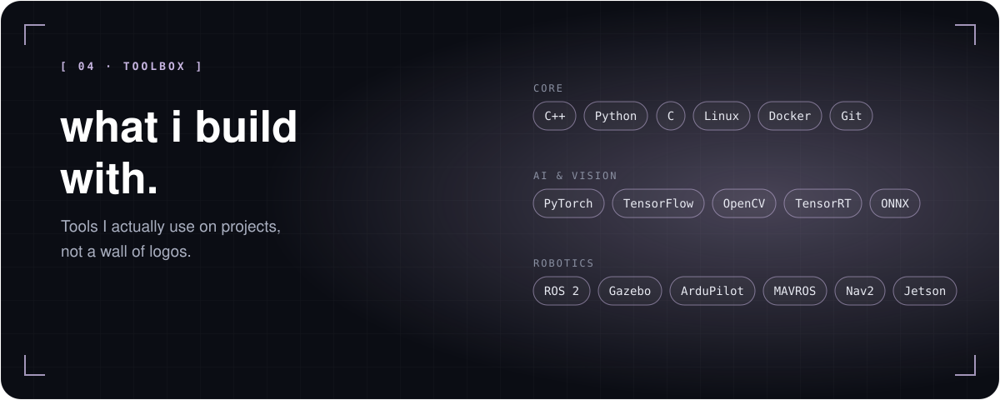

  third-year B.Tech · Electronics &amp; Computer Science · Ramdeobaba University, Nagpur

  🏅 Reached the pre-final rounds at the ISRO Robotics Challenge (IRoC-U 2026), working on computer vision 
  ROS 2 + Gazebo + ArduPilot SITL · MAVROS control from a Jetson · LiDAR filter feeding EKF3 · ORB detection in C++ · ArUco landing correction

  Tata Elxsi Teliport S4 · Round 1 submitted · SQLite + FTS5 event store · grammar-constrained JSON from a 0.5B model · tested on a Raspberry Pi

  Smart India Hackathon · I own the ML architecture and backend deployment · gated fusion, modality dropout, learned "missing" embeddings · rice, wheat, maize, cotton

  side quests: a multi-model local AI companion on Ollama · an offline Gemma fine-tuning pipeline · ESP32, kernel-module and Linux tinkering

  <a href="https://www.linkedin.com/in/adi465996">LinkedIn</a> ·
  <a href="mailto:adi465996@gmail.com">Email</a> ·
  <a href="https://x.com/AdityaS9766">X</a> ·
  <a href="https://github.com/Pain-apk/IOT_project">IOT_project</a>

