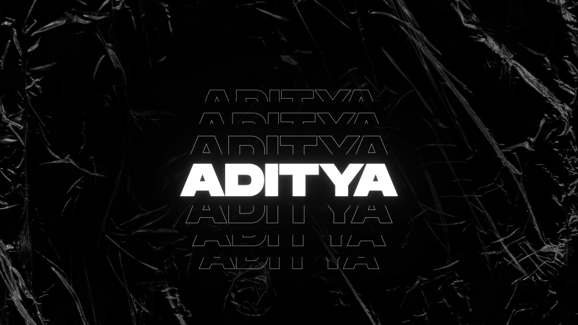

<h2 align="left">Hi  I'm Aditya</h2>

###

###

<h2 align="left">Robotics · Edge AI · Computer Vision</h2>

###

  

    

      
      
      
      
    

  

<h1></h1>

  
  

<h1></h1>

<h2 align="center">🛠️ Tech Arsenal</h2>

  <table align="center" width="100%">
    <tr>
      <td align="center" width="96"> Python</td>
      <td align="center" width="96"> C++</td>
      <td align="center" width="96"> C</td>
      <td align="center" width="96"> Bash</td>
      <td align="center" width="96"> Java</td>
      <td align="center" width="96"> JavaScript</td>
    </tr>
    <tr>
      <td align="center" width="96"> PyTorch</td>
      <td align="center" width="96"> TensorFlow</td>
      <td align="center" width="96"> OpenCV</td>
      <td align="center" width="96"> NumPy</td>
      <td align="center" width="96"> Pandas</td>
      <td align="center" width="96"> SQLite</td>
    </tr>
    <tr>
      <td align="center" width="96"> ROS 2</td>
      <td align="center" width="96"> Linux</td>
      <td align="center" width="96"> Docker</td>
      <td align="center" width="96"> Raspberry Pi</td>
      <td align="center" width="96"> Arduino</td>
      <td align="center" width="96"> Git</td>
    </tr>
    <tr>
      <td align="center" width="96"> HTML5</td>
      <td align="center" width="96"> CSS3</td>
      <td align="center" width="96"> React</td>
      <td align="center" width="96"> Node.js</td>
      <td align="center" width="96"> MongoDB</td>
      <td align="center" width="96"> Django</td>
    </tr>
  </table>

   

  
  
  
  
  
  

<h1></h1>

<h2 align="center">🚀 Featured Projects</h2>

  <table align="center">
    <tr>
      <td align="center" width="360">
        <b>🚁 NIDAR</b> GPS-denied autonomous drone 
        ROS 2 · Gazebo · ArduPilot · MAVROS · C++ · Jetson
      </td>
      <td align="center" width="360">
        <b>🚗 VehicleGPT</b> Offline on-device LLM for vehicle data 
        llama.cpp · SQLite · Python · Raspberry Pi
      </td>
    </tr>
  </table>

  

<h1></h1>

  <blockquote>
    

      "The real danger is not that computers will begin to think like men, but that men will begin to think like computers." - Sydney J. Harris
    

  </blockquote>

<h1></h1>

  

<h1></h1>

<picture>
  <source media="(prefers-color-scheme: dark)" srcset="https://raw.githubusercontent.com/platane/platane/output/github-contribution-grid-snake-dark.svg" />
  <source media="(prefers-color-scheme: light)" srcset="https://raw.githubusercontent.com/platane/platane/output/github-contribution-grid-snake.svg" />
  
</picture>

  
Thanks for stopping by! Feel free to check out my repositories and connect with me.

  

